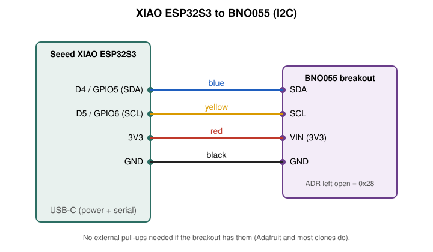

# XIAO ESP32S3 + BNO055 orientation sensor

Get a [Seeed XIAO ESP32S3](https://wiki.seeedstudio.com/xiao_esp32s3_getting_started/) talking to a
Bosch BNO055 9-axis IMU over I2C, and see the orientation live in a 3D viewer in your browser.



## What you need

- Seeed XIAO ESP32S3
- BNO055 breakout (Adafruit or a clone) and four jumper wires
- USB-C data cable
- Chrome or another Web Serial capable browser
- [`arduino-cli`](https://arduino.github.io/arduino-cli/latest/installation/) and Python 3

## Quick start

1. Wire it up as shown above: D4 to SDA, D5 to SCL, 3V3 to VIN, GND to GND. Details in [docs/wiring.md](docs/wiring.md).
2. Install the toolchain and libraries:
   ```bash
   scripts/setup.sh
   ```
3. Optional but recommended, check the sensor is on the bus:
   ```bash
   scripts/flash.sh i2c_scan
   python3 scripts/monitor.py
   # expect: I2C device at 0x28 / BNO055 CHIP_ID = 0xA0
   ```
4. Flash the streaming firmware and check it:
   ```bash
   scripts/flash.sh webserial_3d
   python3 scripts/verify.py
   ```
5. Run the local viewer. It opens `http://localhost:8000` with a live 3D model, and needs no
   browser permissions:
   ```bash
   python3 scripts/viewer.py            # or: python3 scripts/viewer.py COM5 8000
   ```
   The page shows the board with labelled X/Y/Z axes, heading/pitch/roll and calibration status bars.
   Drag to orbit and press `Z` to set the current pose as zero. Close any other program using the
   serial port first. Full details in [docs/viewer.md](docs/viewer.md).

   Alternatively, use Adafruit's browser viewer: close any serial monitor, then open the
   [Adafruit WebSerial 3D viewer](https://adafruit.github.io/Adafruit_WebSerial_3DModelViewer/),
   click **Connect** and pick the XIAO's serial port. Tilt the sensor and the model follows.

The serial port is `/dev/ttyACM0` on Linux. Pass another port as the last argument to
`flash.sh` and to `monitor.py`/`verify.py`, e.g. `scripts/flash.sh webserial_3d COM5`.
Only one program can hold the port at a time.

## Calibration

The BNO055 calibrates itself on every power-up. The viewer shows four values from 0 to 3
(system, gyro, accel, mag). For a good heading:

- Gyro: leave the sensor still for a few seconds.
- Accel: hold it still in several different orientations (six faces if you can).
- Mag: wave it in a figure eight.

## Repository layout

| Path | What it is |
|---|---|
| `firmware/webserial_3d` | Streams orientation, quaternion and calibration at 115200 baud |
| `firmware/i2c_scan` | Scans the bus and reads the BNO055 chip ID |
| `scripts/` | `setup.sh`, `flash.sh`, `monitor.py`, `verify.py`, `viewer.py` |
| `viewer/` | Web page served by `viewer.py` |
| `docs/` | Wiring diagram, viewer guide and troubleshooting |

## Troubleshooting

See [docs/troubleshooting.md](docs/troubleshooting.md).

## Credits and license

`webserial_3d` is adapted from the [Adafruit BNO055](https://github.com/adafruit/Adafruit_BNO055)
example (BSD license). The 3D viewer is Adafruit's. Everything else is MIT, see [LICENSE](LICENSE).
Maintained by [RobotX Workshops](https://github.com/RobotX-Workshops).
